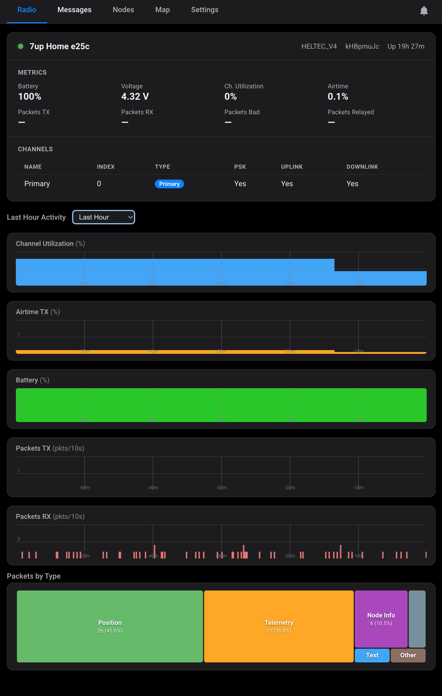
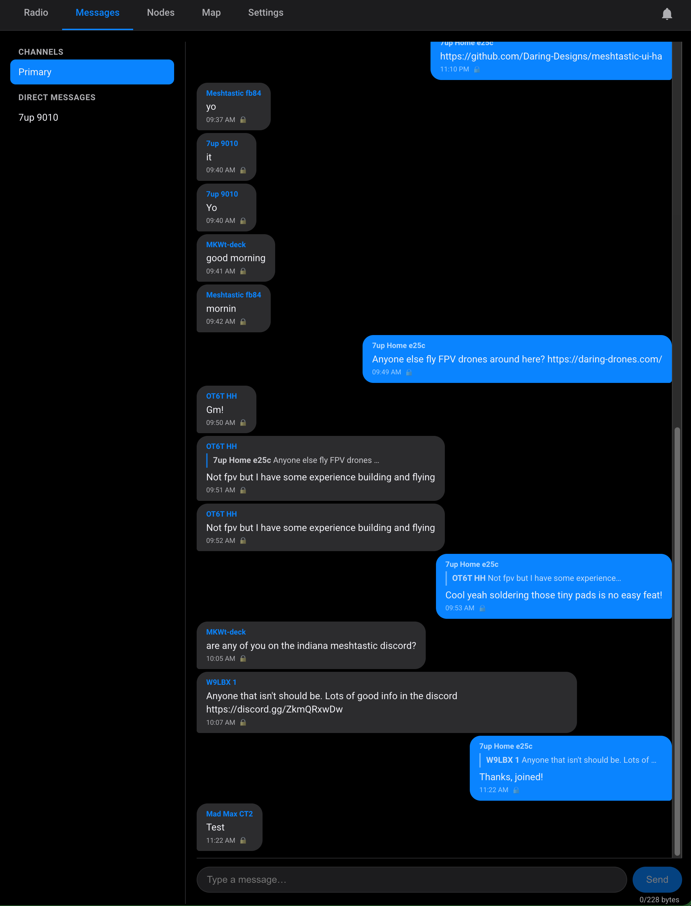
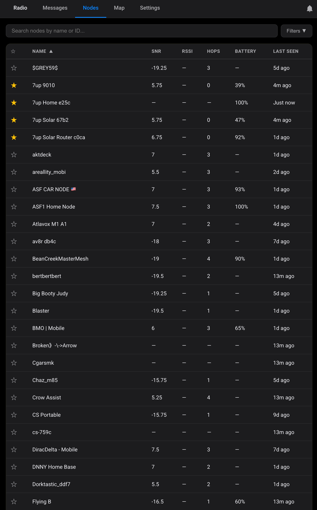
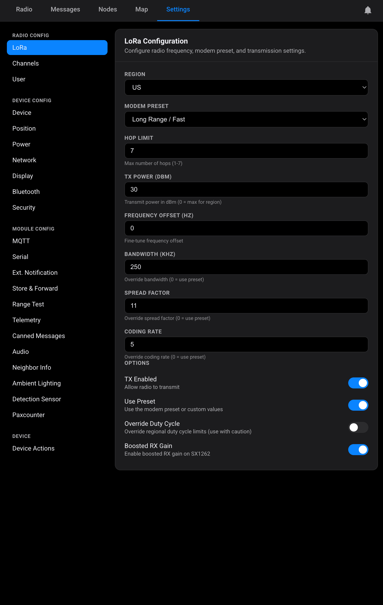
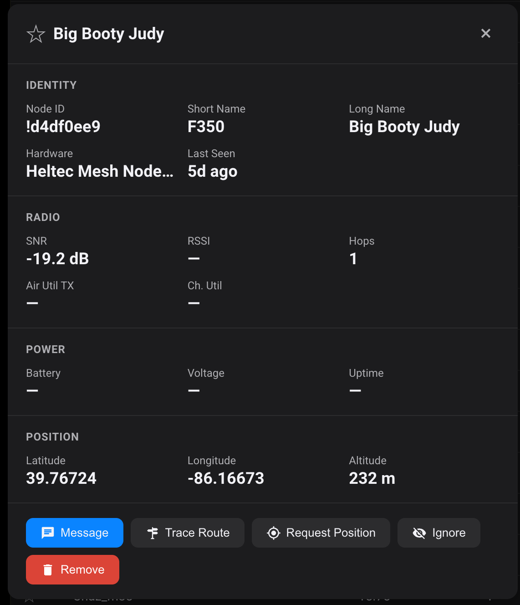

# Meshtastic UI for Home Assistant

> **Beta / Work in Progress** — This integration is under active development. Expect rough edges and breaking changes. If you run into issues, please [open an issue on GitHub](https://github.com/Daring-Designs/meshtastic-ui-ha/issues).

A companion HACS integration that adds a full-featured dashboard for your [Meshtastic](https://meshtastic.org) mesh network in Home Assistant. Connects directly to your radio via TCP, Serial, or Bluetooth (BLE) and provides messaging, node management, mapping, and complete radio configuration — all from the HA sidebar.

## Built With

- **Backend** — Python, using the [meshtastic](https://pypi.org/project/meshtastic/) library for all radio communication (TCP, Serial, BLE). Integrates with Home Assistant via its WebSocket API and async event system.
- **Frontend** — Vanilla ES modules built with [Lit](https://lit.dev/) 4.x web components, [Leaflet](https://leafletjs.com/) for mapping, and [D3](https://d3js.org/) for real-time charts. Vendor libraries are bundled via a build step; app-level JS is served directly by Home Assistant.

## Why Connect a Radio to Home Assistant?

A Meshtastic node plugged into your Home Assistant server becomes an **always-on gateway** to your mesh network. Unlike a phone or laptop that goes to sleep, a home server runs 24/7 — so your node never misses a message.

- **Never miss a message** — Every channel broadcast and direct message is captured and stored, even when your phone is off or out of range. Come back hours or days later and scroll through the full history.
- **Send messages from anywhere** — Open your HA dashboard from any browser or the HA mobile app and send messages to your mesh. Useful for remote check-ins or coordinating with people in the field when you're away from home.
- **Long-term message and node history** — All messages, node sightings, waypoints, and traceroute results are persisted to disk and survive HA restarts. Build up weeks of mesh activity without losing data.
- **Monitor your mesh passively** — Real-time charts track channel utilization, airtime, battery, and packet rates. See at a glance how busy your mesh is and whether your gateway node is healthy.
- **Automate with HA** — Pair with HA automations to get push notifications on your phone when a message arrives, trigger alerts based on node status, or log mesh telemetry to long-term databases like InfluxDB.

## Screenshots

| Radio | Messages | Nodes |
|:---:|:---:|:---:|
|  |  |  |

| Map | Settings | Node Detail |
|:---:|:---:|:---:|
|  |  |  |

## Features

### Radio Tab

Gateway status dashboard showing connection state, hardware info, firmware version, uptime, battery, voltage, channel utilization, air utility TX, and packet counters (TX/RX/bad/relayed). Displays a channel table with name, index, role, PSK status, and uplink/downlink flags.

### Messages Tab

Chat-style messaging interface for both channel broadcasts and direct messages. Conversations are listed in a sidebar with channels and DM threads. Messages show sender name, timestamp, and delivery status icons (pending, delivered, failed). Includes a byte counter (228-byte Meshtastic limit) on the input field. Messages persist across restarts.

### Nodes Tab

Sortable, searchable table of all mesh nodes. Columns include favorite star, name, SNR, RSSI, hops, battery, and last seen time. Expandable filter panel with last heard window, minimum battery, maximum hops, and favorites-only toggle. Ignored nodes display a badge.

Click any node to open a detail dialog with identity, radio, power, environment, and position sections. Action buttons:

- **Send Message** — opens a DM conversation
- **Trace Route** — sends a traceroute request
- **Request Position** — asks the node for a GPS update
- **Favorite / Unfavorite**
- **Ignore / Unignore**
- **Remove Node** — deletes from the local database

### Map Tab

Interactive Leaflet/OpenStreetMap visualization with toggleable layers:

- **Nodes** — green (recent) and orange (stale) circle markers with popups
- **Waypoints** — blue diamond markers with name and description
- **SNR Lines** — colored by signal quality (green to red)
- **Traceroute Routes** — purple dashed lines showing mesh paths; click to see hop-by-hop details with SNR values

Auto-fits bounds to visible nodes. Shows a badge counting nodes without position data.

### Stats Tab

At-a-glance summary cards: messages today, active nodes, total nodes, and channel count.

### Settings Tab

Complete radio configuration UI matching the Meshtastic web app. All changes are written directly to the radio.

**Radio Config:**

- **LoRa** — region (20+ options), modem preset, hop limit, TX power, bandwidth, spread factor, coding rate, frequency offset, TX enabled, boosted RX gain, override duty cycle
- **Channels** — per-channel editor for all 8 slots: role, name, PSK (with generate), uplink/downlink, position precision

**Device Config:**

- **Owner** — long name, short name, licensed operator flag

**Module Config (12 panels):**

- **MQTT** — broker address/port/credentials, root topic, encryption, JSON, TLS, proxy to client, map reporting
- **Serial** — baud rate, mode (default/simple/protobuf/text/NMEA/CalTopo), GPIO pins, timeout, echo
- **External Notification** — output/vibra/buzzer GPIO, nag timeout, duration, alert triggers, PWM mode, polarity
- **Store & Forward** — records count, history return max/window, heartbeat, server role
- **Range Test** — sender interval, save to file
- **Telemetry** — device/environment/air quality/power metric intervals and display toggles
- **Canned Messages** — pipe-separated message list, input source (rotary encoder/up-down), GPIO pins, send channel
- **Audio** — Codec2 enable/bitrate, PTT GPIO, I2S pin config
- **Neighbor Info** — update interval
- **Ambient Lighting** — LED state, RGB color, brightness
- **Detection Sensor** — monitor pin, broadcast intervals, custom trigger messages, bell notification, pullup
- **Paxcounter** — update interval, WiFi/BLE counting toggles

**Device Actions:**

- Reboot
- Shutdown
- Factory Reset Config
- Factory Reset Device
- Reset Node Database
- Reboot OTA

### Home Assistant Entities

Each radio is a device in Home Assistant with:

- **Messages Today** and **Active Nodes** sensors
- **Radio connected** — a connectivity binary sensor, on while the link to the radio is up
- **Notifications** — a switch for the panel's push notifications
- The radio's own battery, voltage, channel utilization, airtime and uptime, plus any environment sensors attached to it

**Other nodes on the mesh get entities only when you pick them.** A busy mesh has hundreds of nodes, so nothing is created for them by default. To add one, open it in the Nodes tab and click **Add to Home Assistant**, or go to **Settings → Devices & services → Meshtastic UI → Configure** and choose nodes from the list. Each picked node becomes its own device, linked to the radio that hears it, with:

- Device metrics: battery, voltage, channel utilization, airtime, uptime
- Link quality as your radio hears it: SNR, RSSI, hops away, last heard
- Environment metrics: temperature, humidity, pressure, gas resistance, IAQ, light (lux, white, IR, UV), wind, rainfall, soil moisture and temperature, weight, distance, radiation
- Air quality: PM1.0, PM2.5, PM10, CO₂
- Power metrics: INA voltage and current on channels 1–3
- A location tracker from the node's position broadcasts

A sensor appears the first time the node reports that reading, so a node with no environment sensor never gets an empty temperature entity. Remote nodes send telemetry on their own schedule (often hourly on firmware 2.7). Use the `meshtastic_ui.request_telemetry` action to ask for a fresh reading.

Removing a node (the same button, the Configure dialog, or deleting its device) removes its entities.

### Actions

All actions are in **Developer tools → Actions** under `meshtastic_ui`. Wherever an action takes a node, you can give the node ID (`!a1b2c3d4`) or its exact long or short name. If you have more than one radio, choose one with `config_entry_id`.

| Action | What it does |
| --- | --- |
| `meshtastic_ui.send_message` | Send text to a channel (`channel`, default 0) or as a direct message (`to`). Up to 228 bytes. Returns the `packet_id`. |
| `meshtastic_ui.send_waypoint` | Share a map waypoint, with an optional expiry in hours. |
| `meshtastic_ui.request_telemetry` | Ask a node for `device`, `environment`, `air_quality` or `power` telemetry. Its sensors update when the answer arrives. |
| `meshtastic_ui.request_position` | Ask a node for its current position. |
| `meshtastic_ui.request_nodeinfo` | Ask a node for its name and hardware. |
| `meshtastic_ui.trace_route` | Trace the hops to a node. The result shows on the panel's map. |

Only admin users can run these actions from the UI. Automations and scripts can always run them. Messages sent by an action show up in the panel's chat with delivery ticks like any other.

### Automation Triggers

Every received text message fires a `meshtastic_ui_message_received` event. Use it with an event trigger, or pick **Device → (your radio or a node) → Message received** in the automation editor.

| Event data | |
| --- | --- |
| `message` | The text |
| `from`, `from_name`, `from_short_name` | Sender node ID and names |
| `type` | `channel` or `dm` |
| `channel` | Channel index |
| `to` | Destination node ID (`^all` for channel messages) |
| `pki_encrypted` | `true` for a direct message end-to-end encrypted to your radio |
| `authenticated` | `true` for a PKI-encrypted direct message heard over LoRa (not MQTT). See the security note below |
| `snr`, `rssi`, `hops_away`, `via_mqtt`, `message_id`, `reply_id`, `config_entry_id` | Packet details |

Messages from ignored nodes don't fire the event, and neither does a message that was already received (same sender and packet ID), so a recorded message replayed over the air is dropped. Every outgoing message also fires `meshtastic_ui_delivery_status` with `status` (`delivered`, `failed` or `timeout`), `packet_id`, `to`, `channel`, `message` and `error`.

The **Direct message received from this node** device trigger only fires for authenticated messages.

> [!WARNING]
> **Don't use mesh messages to control locks, doors, alarms or anything else that matters.** Meshtastic was not built to authenticate commands:
>
> - **Channel messages prove nothing about the sender.** Anyone in range who knows the channel key can send as any node, and the default keys are public.
> - **`authenticated` depends on your radio's firmware.** Before 2.7.15, anyone with the channel key could forge a direct message that looked PKI-encrypted ([CVE-2025-53627](https://github.com/meshtastic/firmware/security/advisories/GHSA-377p-prwp-4hwf)). Some vendors also shipped radios with cloned keys ([CVE-2025-52464](https://nvd.nist.gov/vuln/detail/CVE-2025-52464)); those need a full wipe.
> - **Node keys are trusted on first sight.** If your radio has never heard the real node, or has forgotten it, someone else can claim its ID with their own key. Favorite the nodes you rely on so your radio keeps their keys.
> - **The message text is whatever the sender typed.** Don't pass it into templates or actions that do anything with it.
>
> Use these events for notifications, logging and replies. If you still automate something from a message, require `authenticated: true` and a specific `from`.

```yaml
automation:
  # Push a phone notification when a node sends a direct message.
  - alias: "Mesh: DM notification"
    triggers:
      - trigger: event
        event_type: meshtastic_ui_message_received
        event_data:
          type: dm
    actions:
      - action: notify.mobile_app_my_phone
        data:
          title: "Mesh DM from {{ trigger.event.data.from_name or trigger.event.data.from }}"
          message: "{{ trigger.event.data.message }}"

  # Broadcast the porch weather every three hours.
  - alias: "Mesh: weather report"
    triggers:
      - trigger: time_pattern
        hours: "/3"
    actions:
      - action: meshtastic_ui.send_message
        data:
          channel: 0
          message: >-
            Porch {{ states('sensor.porch_temperature') }}°C,
            {{ states('sensor.porch_humidity') }}% RH
```

### Real-Time Updates

Five WebSocket subscriptions provide live updates without polling:

- Incoming messages
- Node status changes
- Message delivery acknowledgements
- Waypoint changes
- Traceroute results

### Data Persistence

All data persists across Home Assistant restarts: messages (channel and DM), node database, favorites, ignored nodes, waypoints, traceroute results, and daily message counters.

## Connection Types

| Type | Details |
|------|---------|
| **TCP/IP** | Hostname + port (default 4403) |
| **Serial** | USB device path (auto-detected) |

Auto-reconnects with exponential backoff (5s to 5min) on connection loss.

## Multiple Radios

You can add more than one radio by running the **Add Integration** flow once per device. Each connection becomes its own config entry with an independent dashboard, message log, node database, and storage file — there is no shared "merged mesh" view across radios.

**For most users, one connected radio is enough.** A single gateway already records every packet it hears over the air, including messages sent by your other radios on the same mesh. Adding a second radio as a separate integration mostly just gives you two copies of the same log.

It's worth running two when the radios actually hear different things:

- **Different physical locations** — e.g. one in the house, one in a detached garage or remote shed, covering different parts of the mesh.
- **Different channels or PSKs** — a radio only decodes channels it has keys for, so two radios on different channel sets will log non-overlapping traffic.
- **Different roles or regions** — e.g. a CLIENT on one mesh and a ROUTER on another.

Storage is isolated per entry, so dashboards and history never bleed between radios, and removing one integration instance won't affect the other's data.

## Prerequisites

- Home Assistant 2024.1+
- A Meshtastic radio accessible via TCP, Serial, or Bluetooth (BLE)
- For BLE: a Bluetooth adapter on the Home Assistant host. The radio has to be paired with a PIN through BlueZ, so radios that HA only reaches through an ESPHome Bluetooth proxy won't connect. Keep the adapter away from Wi-Fi routers and access points: a 2.4 GHz transmitter a few inches away can deafen it and drop the link every few minutes. If that happens, use a USB Bluetooth adapter on an extension cable.
- The `meshtastic` Python package (installed automatically as a dependency)

## Installation

### HACS (Recommended)

1. Open **HACS** in Home Assistant
2. Click the three-dot menu > **Custom repositories**
3. Add `https://github.com/Daring-Designs/meshtastic-ui-ha` with category **Integration**
4. Find **Meshtastic UI** and click **Download**
5. Restart Home Assistant
6. Go to **Settings > Devices & Services > Add Integration** and search for **Meshtastic UI**
7. Select your connection type and enter the connection details

### Manual

Copy the `custom_components/meshtastic_ui` folder into your Home Assistant `config/custom_components/` directory, restart, and add the integration.

## Architecture

```
Frontend (Lit 4.x, ES modules)            Backend (Python, WebSocket API)
───────────────────────────────            ────────────────────────────────
ha_frontend/                               custom_components/meshtastic_ui/
  panel.js    (shell + router)               connection.py  (radio I/O)
  views.js    (5 tab components)             websocket_api.py (23 WS commands)
  settings.js (config panels)                store.py (persistent storage)
  modules.js  (module config panels)         config_flow.py (setup wizard)
  components.js (shared form widgets)        sensor.py (HA sensor entities)
                                             services.py (HA actions)
  styles.js   (shared CSS)                   const.py (constants + signals)
```

The frontend is built with [Lit](https://lit.dev/) web components. The backend communicates with the radio through the [meshtastic](https://pypi.org/project/meshtastic/) Python library, with all blocking calls wrapped in `async_add_executor_job()`. Frontend and backend communicate exclusively via Home Assistant's WebSocket API.

## License

MIT
